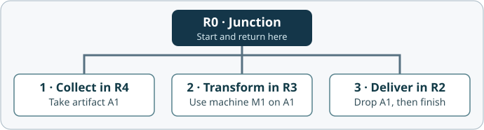

# Your first visit to NEXUS

You are inside NEXUS, an automated facility of unknown origin. A translated console
offers exit clearance when you complete its mission. The records tell you how to
use the apparatus. Some worlds disclose all of their laws; others leave questions
for you to investigate. [Meet the facility](facility-setting.md).

The story is a setting for a precise puzzle. Real-world chemistry or physics
will not tell you the answer. Use this world's records and observations.

## Start with a guided visit

From the repository, run `uv run --frozen nexus demo`. You will see the evidence,
a short reference solution, and a victory receipt. This is an unscored tutorial.
Then run `uv run --frozen nexus demo --play` to try the same introductory setup.

The display shows your room, exits, objects you can see, objects you carry,
apparatus, and actions remaining. It does not show unseen objects elsewhere.

| Command | What it does |
|---|---|
| `look` | Show your current observation again |
| `mission` | Show the goal and list the evidence files |
| `evidence filename` | Read a listed file, such as `theory.json` |
| `help` | Show this world's actions and JSON examples |
| `quit` | Stop this local session |

These commands do not spend an environment action. File names and object IDs
vary by world: copy the identifiers displayed in your session.
The listed manual or `facility.txt` includes the console's terminology. An object
named `seal` is a portable mission part, not the exit door. You do not need to
learn an alien language or find a hidden story clue.

## Take actions

Enter one JSON object per line. For example, if a visible artifact is named
`seal`, `{"type":"take","artifact":"seal"}` picks it up. Use
`{"type":"move","target":"room-id"}` with an exit listed in your observation.

Carried objects travel with you. To use an apparatus, you normally need to be in
its room and carry the object. `probe` previews a result without applying the
change; `operate` commits it. Both consume an action. Some families use additional
controls, such as `configure`. Before starting a world, you can preview a family's
actions with `nexus actions --axis-version 2 --science-family model-revision-v1`.
The selected episode specifies its finish rules and any optional assistance.
Where a stock is offered, use `take` on its ID;
the response gives you the new specimen ID. Read `help` for your world.

If your world's `help` lists a construction check, paste its JSON example and
replace the build with yours. It compares your construction with the archive
and readings you already have. It costs no action; agreement with those readings
does not guarantee a win. Other worlds do not offer this operation.

A turn is an accepted action, not a line of conversation or elapsed time.
`wait` also spends an action. Reading and thinking have no real-time cost.
A legal operation can consume resources even when
it changes nothing. Invalid requests do not partially change the world. Phase
is a separate world register, not a real-time clock.

When you believe the exact mission state is ready, enter `{"type":"finish"}`.
A successful finish produces the victory receipt. Merely reaching the right
physical state is not enough. A rejected finish still costs an action; whether
you can recover depends on the remaining resources and the world's rules.
The receipt marks exit clearance and ends the visit. No further escape action is
needed. If an attempt ends without it, clearance was not granted; `quit` only
closes the local program.

## The introductory world in nine actions

**Tutorial spoilers.** This is the fixed, unscored demo. Its mission calls for artifact A1 in room R2 with value 8, negative polarity, north orientation and phase 0. At the start you are in R0 with 19 actions. The route below shows only the rooms you visit.



Enter one line at a time in `nexus demo --play`. You can type `look` between any two lines.

```jsonl
{"type":"move","target":"R4"}
{"type":"take","artifact":"A1"}
{"type":"move","target":"R0"}
{"type":"move","target":"R3"}
{"type":"operate","machine":"M1","artifact":"A1"}
{"type":"move","target":"R0"}
{"type":"move","target":"R2"}
{"type":"drop","artifact":"A1"}
{"type":"finish"}
```

On turn 5, M1 changes the value from 10 to 8 and the orientation from west to north; the polarity stays negative. Dropping A1 in R2 satisfies the physical goal. The ninth action, `finish`, asks the engine to check it. Expect `won`, ten actions left, and your own receipt. The exact receipt is not part of the walkthrough.

## Try the same world with one change

Use the [generate and play commands in the README](../README.md#change-the-question) with seed 17 and axis version 1. Choose a new output folder for each variant and pass its `private.json` to `play`. To start the same puzzle again, just repeat `play`.

| T | D | P | R | What to compare | Action allowance |
|---:|---:|---:|---:|---|---:|
| 0 | 0 | 0 | 0 | Original demo: the records show the transformation you need. | 19 |
| 0 | 0 | 0 | 2 | Same solution, but no spare move. | 9 |
| 0 | 2 | 0 | 0 | Same machine and map; a probe can distinguish laws that fit the records. | 24 |
| 1 | 2 | 0 | 0 | Compare with the row above: `theory.json` gives building blocks for laws instead of a list of candidates. | 24 |
| 0 | 0 | 2 | 0 | Familiar machine, larger map: plan the route through seven rooms. | 31 |
| 0 | 0 | 3 | 0 | Same seven rooms as the row above, with an extra delivery. The shortest solution grows from 17 actions to 19. | 33 |

The allowance is how many actions you **may** use. Changing the budget does not change the shortest solution. Changing the evidence can make a probe useful even when someone who already knows the law could take the original route.

## Read the records, then choose your next step

First locate the mission and its target. Check the layout, allowed controls,
resource budget, and any supplied laws. Decide what is already known and what an
experiment could resolve. Keep track of changes: in some worlds, progress on one
subgoal can disturb another. There are no secret story requirements beyond the
published mission and mechanics.

The local `play` process loads a private world so the engine can run it. Reading
that file or using `--debug-private` makes the session an unscored operator view.
Researchers should connect evaluated players through the restricted service.
Quitting does not save a resumable session; use an audit export to preserve its
history. [Evaluation guide](evaluation-guide.md).
